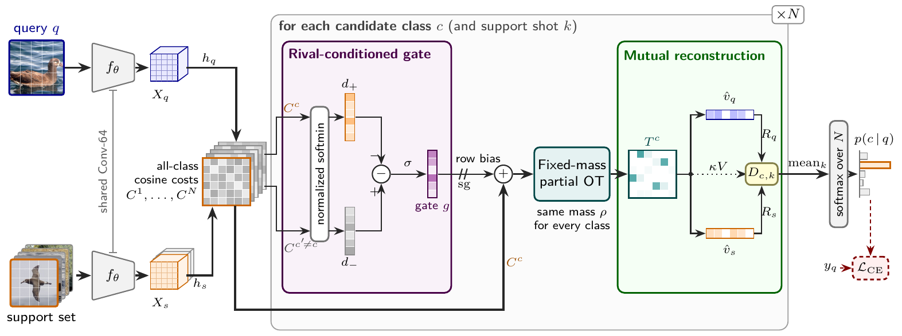

<div align="center">

<h1>Rival-Aware Partial Transport for Few-Shot<br>Fine-Grained Image Classification: A Mechanism Study</h1>

**Nishi Kanta Paul**<sup>1</sup> &nbsp;·&nbsp; **Md Shihabul Islam Shovo**<sup>1</sup> &nbsp;·&nbsp; **Hoileong Lee**<sup>2</sup>

<sup>1</sup>NIMISHES Lab, Dhaka, Bangladesh &nbsp;&nbsp; <sup>2</sup>Faculty of Electronic Engineering and Technology, Universiti Malaysia Perlis

*Preprint submitted to Neurocomputing*


</div>

<p align="center">
  
</p>

<p align="center"><em>
For each candidate class and support shot, a rival-conditioned gate compares the matching cost of every query patch to the candidate
with its cost to the pooled rivals and biases the rows of the transport cost. Fixed-mass partial OT uses the same coverage for every
candidate and shot, and one coupling yields both barycentric reconstructions.
</em></p>

## Overview

Few-shot fine-grained classification needs local evidence that separates visually similar classes. Class-agnostic patch matching can
spend its budget on an **easy-match shortcut**: background and structure shared by every candidate. This repository implements a
rival-aware partial transport framework that turns episode-relative matching margins into an additive query-row cost under a common
transported-mass budget, with shared or candidate-specific gates and query-only, support-only or mutual reconstruction scored from a
single coupling. **CaPT-MR** is its candidate-specific, mutual-scoring configuration (A3).

The code reproduces the full study: the benchmark on CUB-200-2011, Stanford Dogs and Stanford Cars, the allocation and scoring
controls, the strong reconstruction baselines, the ResNet-12 panel, the many-way and controlled-perturbation follow-ups, resource
profiling, and every numerical transport check on procedural descriptors.

## Highlights (as reported in the paper)

- **Shared rival-aware allocation helps.** C2-max improves over ungated partial transport (A2) by **0.5-1.0 pp** in all six
  dataset-shot settings, with positive simultaneous lower bounds throughout the six-setting family.
- **Candidate-specific gating is not a guaranteed extra.** A3 versus the best shared rule has one positive simultaneous interval
  (CUB 1-shot), and no lower bound exceeds the working 0.3 pp practical margin.
- **Equal coverage does not prevent wrong-candidate subset selection.** On fixed features the gate lowers the residual of wrong
  candidates more often than that of true candidates.
- **Mutual scoring is not uniformly better.** It beats separately trained query-only scoring in three of six settings.

| Method (Conv-64) | CUB 1-shot | CUB 5-shot | Dogs 1-shot | Dogs 5-shot | Cars 1-shot | Cars 5-shot |
|:---|:---:|:---:|:---:|:---:|:---:|:---:|
| Bi-FRN | 63.0 | 80.9 | 47.3 | 66.3 | 53.6 | 76.4 |
| SFMR | 64.2 | 81.6 | 48.3 | 67.0 | 54.0 | 76.8 |
| Partial OT, no gate (A2) | 63.1 | 80.6 | 46.9 | 65.7 | 52.7 | 75.1 |
| Shared rival gate (C2-max) | 64.1 | 81.2 | 47.8 | 66.5 | 53.5 | 75.6 |
| **CaPT-MR (A3)** | **64.8** | 81.5 | **48.4** | 66.6 | 53.6 | 75.9 |

<sub>5-way accuracy (%), raw 84x84 inputs, ten paired training seeds, 2,000 fixed episodes per seed. Baselines are common-protocol
adaptations, not published scores.</sub>

## Method

For a query with normalized patch descriptors $h_q$ and supports $h_{c,k}$, the costs are $C^{c,k}_{ij}=1-h_q(i)^\top h_{c,k}(j)$.
Normalized soft minima give the candidate and rival costs $d_+(i,c)$ and $d_-(i,c)$; the rival pools are computed from per-class
log-sum-exp pools with prefix/suffix scans, never by subtracting the candidate from the total. The margin $m=d_--d_+$ defines the gate
$g(i,c)=\sigma(m/\eta)$, which enters only as a stop-gradient row bias $\lambda_g[1-g(i,c)]$. The coupling solves entropic partial
transport with uniform capacities and total mass $\rho$ by log-domain Dykstra projections (Sinkhorn at $\rho=1$), stopping on plan
change and feasibility together. Both barycentric residuals come from the same coupling, and $D=R+\kappa V$ with $\kappa=0$ as the
primary score.

| Code | Configuration |
|:---|:---|
| A0 | Dense softmax attention in both reconstruction directions (no OT) |
| A1 | Balanced OT, $\rho=1$, no gate (gated full mass is identical) |
| A2 | Partial OT, $\rho=0.6$, no gate |
| **A3** | A2 + candidate-specific rival gate, mutual reconstruction (**CaPT-MR**) |
| A3-query / A3-support | A3 scored with $R_q$ or $R_s$ only |
| C1 | Candidate-only gate $\sigma((b-d_+)/\eta_+)$ |
| C2-max / C2-mean / C2-weighted | One shared gate per query row from the max, mean or softmax-weighted candidate margins |
| C3 | Top $\rho L$ rows by margin, capacity-free softmax |
| C4 | A3 gate under a fixed spatial permutation |
| Anchored | 75% shared-max bias + 25% candidate-specific bias (diagnostic) |

## Repository structure

```
.
├── main.py                 entry point; runs the pipeline stage by stage
├── models/
│   ├── backbones.py        Conv-64 and ResNet-12 encoders (L = 25 descriptors at 84x84)
│   ├── transport.py        costs, stable rival pools, gates, log-domain partial OT, residuals and dispersion
│   ├── heads.py            allocation family A0-A3, C1-C4, anchored control
│   ├── baselines.py        ProtoNet, DN4, DMN4, DeepEMD, FRN, Bi-FRN, BSNet, TDM, SFMR adaptations
│   └── fewshot.py          backbone + head + learnable logit scale, method registry
├── util/
│   ├── datasets.py         CUB-200-2011, Stanford Dogs, Stanford Cars loading, class splits, V_tune/V_conf, image cache
│   ├── episodes.py         fixed evaluation manifests, shared training streams and augmentation
│   ├── perturbations.py    query-only interventions including background replacement
│   ├── reference_ot.py     NumPy multiplicative reference solver, exact LP, reconstruction terms
│   ├── procedural.py       procedural descriptor generator (shared background, overlapping class parts)
│   ├── verify.py           numerical checks of Propositions 1-3, sensitivity chain, allocation and stopping rule
│   ├── probes.py           fixed-feature probes, transitions, directions, ambiguity bands, convergence, kernel timing
│   ├── train.py            episodic training, checkpoint selection, evaluation with diagnostics
│   ├── engine.py           experiment registry and pipeline stages with caching and resume
│   ├── stats.py            seed-level t intervals, paired contrasts, Bonferroni families, best-shared bounds
│   ├── evaluate.py         all estimands of the paper
│   ├── report.py           figures and LaTeX / Markdown / CSV tables
│   └── utils.py
├── scripts/
│   ├── env.sh              keeps the environment and caches inside the repository
│   └── run_full.sh         full experiment
├── assets/
└── requirements.txt
```

## Installation

The code was developed with Python 3.12 and PyTorch 2.6. From the repository root:

```bash
python3.12 -m venv .venv
source scripts/env.sh
"$PYTHON" -m pip install -r requirements.txt
```

`scripts/env.sh` keeps the pip, torch and matplotlib caches in `.cache/` inside the repository. The qualitative reference maps
download ImageNet ResNet-50 weights from torchvision on first use.

## Data

Place the datasets under `data/` (or pass `--data-root`, `--cub-path`, `--dogs-path`, `--cars-path`):

```
data/
├── CUB_200_2011/    images/, images.txt, image_class_labels.txt, classes.txt, bounding_boxes.txt
├── StanfordDogs/    Images/, Annotation/
└── StanfordCars/    cars_train/, cars_test/, devkit/cars_meta.mat, devkit/cars_train_annos.mat, cars_test_annos_withlabels.mat
```

CUB uses the 100/50/50 class split (even class indices for training, then alternating validation and test); its 50 validation classes
are divided by `--split-seed` into the 25-class pools V_tune (checkpoint and hyperparameter selection) and V_conf (confirmation).
Stanford Dogs (70/20/30) and Stanford Cars (130/17/49) use a fixed seeded class permutation; pass `--split-dir` with
`{dataset}_split.csv` files (`class_id,split`) to use other partitions. Images are used raw and uncropped at 84x84; boxes are used only
for diagnostics and the background intervention.

## Reproducing the paper

Run every stage in order:

```bash
bash scripts/run_full.sh
```

The computed transport diagnostics need no data or GPU and take a few minutes on a CPU:

```bash
bash scripts/run_full.sh --stage verify --device cpu
bash scripts/run_full.sh --stage probe --device cpu
```

Or run the stages one at a time. Each stage caches its outputs and resumes after an interruption; add `--overwrite` to recompute.

```bash
python main.py --stage split
python main.py --stage verify
python main.py --stage probe
python main.py --stage tune --use-tuned
python main.py --stage train
python main.py --stage infer
python main.py --stage manyway
python main.py --stage perturb
python main.py --stage profile
python main.py --stage qualitative
python main.py --stage evaluate
python main.py --stage report
```

| Stage | Description |
|:---|:---|
| `split` | Class splits, V_tune/V_conf pools, 84x84 image cache, fixed evaluation manifests |
| `verify` | Residual-dispersion identity, full-mass neutrality, sensitivity chain, tied costs, pool composition, allocation, stopping rule |
| `probe` | Easy and harder fixed-feature probes, transitions, directional rescoring, ambiguity bands, convergence, residual-kernel timing |
| `tune` | Validation-only search: A2 entropy, then 12 gate trials per gated control (applied with `--use-tuned`) |
| `train` | Episodic training of every configuration, backbone and seed, checkpoint selection on V_tune every 500 episodes |
| `infer` | Test, V_conf and V_tune evaluation; transport diagnostics and residual/dispersion terms for the kappa sweep |
| `manyway` | Frozen 1-shot checkpoints at 5/10/20/50 ways with one support and one query per class |
| `perturb` | Query-only blur, JPEG, brightness, contrast, noise and background replacement at three severities |
| `profile` | Model-forward latency, peak memory, stage times, OT sweeps and training-step time |
| `qualitative` | Reference participation maps on ImageNet ResNet-50 features |
| `evaluate` | All estimands with seed-level and paired intervals |
| `report` | Figures and tables |

`--experiments` selects the primary benchmark, the V_conf confirmation panel, the coverage sweep, the kappa diagnostic and the
ResNet-12 panel; `--datasets`, `--shots`, `--methods` and `--seeds` restrict any stage.

### Default configuration

The defaults in `main.py` follow the paper.

| Setting | Flag | Default |
|:---|:---|:---|
| Coverage $\rho$ / entropy $\epsilon$ | `--rho`, `--entropy` | 0.6, 0.05 |
| Gate weight $\lambda_g$ / temperatures $\eta$, $t_m$ | `--lambda-g`, `--eta`, `--t-m` | 0.25, 0.1, 0.1 |
| Dispersion weight $\kappa$ | `--kappa` | 0 |
| Solver tolerances / cap | `--ot-tol`, `--ot-feas-tol`, `--ot-max-iter` | 1e-4, 1e-5, 500 |
| Training episodes / queries per class | `--train-episodes`, `--train-queries` | 10,000, 5 |
| SGD | `--lr`, `--momentum`, `--weight-decay` | 0.01, 0.9, 5e-4 (tenfold decay at 60% and 85%) |
| Logit scale initialization | `--tau-init` | 10 |
| Evaluation | `--test-episodes`, `--test-queries` | 2,000 5-way episodes, 15 queries per class |
| Training seeds | `--seeds` | 13 29 47 61 79 97 113 131 149 167 |
| Practical criterion | `--practical-margin`, `--latency-budget`, `--memory-budget` | 0.3 pp, 5%, 2% |

Run `python main.py --help` for the full list.

## Outputs

Everything is written to `results/full/`. `report/` contains each paper table as `.md`, `.tex` and `.csv`, and each figure as `.pdf` and
`.png`; `metrics/` contains `results.json`, `summary.csv`, per-seed accuracies and the A3-minus-C2-max seed differences.

| Paper item | Generated file |
|:---|:---|
| Table: five-way accuracy and resources | `tab_main`, `tab_main_resources` |
| Table: component contrasts | `tab_components` |
| Table: shared versus candidate-specific allocation | `tab_shared_variants`, `_contrasts`, `_costs` |
| Table: directional training | `tab_directional_training`, `_costs` |
| Table: strong reconstruction baselines | `tab_strong_baselines`, `_ratios` |
| Table: ResNet-12 panel | `tab_backbone_summary`, `_contrasts`, `tab_backbone`, `tab_backbone_bifrn`, `tab_followup_backbone` |
| Table: computed mechanisms | `tab_computed_mechanisms`, `tab_directions`, `tab_transitions` |
| Table: V_conf confirmation | `tab_confirm` |
| Table: practical-margin sensitivity | `tab_practical_effect` |
| Supplement: paired seeds, transitions, robustness | `tab_c2_test`, `_seeds`, `tab_trained_transitions`, `tab_robust`, `_background` |
| Supplement: diagnostics, efficiency, costs, operating region | `tab_diag`, `_cost`, `_stages`, `tab_efficiency`, `tab_followup_cost*`, `tab_operating_region*` |
| Supplement: ambiguity bands, convergence, kernel costs, verification | `tab_ambiguity_*`, `tab_computed_cost_convergence`, `tab_directional_kernel`, `tab_verification` |
| Figures | `fig_toy_transport`, `fig_coverage_dispersion`, `fig_many_way`, `fig_perturbations`, `fig_harder_gate_probe`, `fig_qualitative_transport`, `fig_dataset_examples` |

## Notes on the implementation

- All baselines are common-protocol adaptations on the same backbone, inputs, episodes and training budget, as in the paper. SFMR is
  adapted from its description (frequency-decoupled streams, saliency-weighted aggregation and bidirectional reconstruction); TDM
  re-weights channels from support and query statistics before FRN reconstruction; DeepEMD uses Sinkhorn with cross-reference marginals.
- The paper does not specify the procedural descriptor generator beyond its parameters (25 rows, 64 channels, 10 background rows,
  separation and noise). `util/procedural.py` mixes shared background prototypes with overlapping class part prototypes at those
  parameters, so computed diagnostics reproduce the stated properties and mechanisms rather than every digit of the paper's tables.
- Solves that reach the 500-sweep cap are counted as unconverged; at inference they continue up to `--ot-fallback-iter` sweeps.

## Intended use

This repository is for research on few-shot fine-grained recognition and the analysis of transport-based matching.

## Citation

```bibtex
@article{paul_rivalaware,
  title   = {Rival-Aware Partial Transport for Few-Shot Fine-Grained Image Classification: A Mechanism Study},
  author  = {Paul, Nishi Kanta and Shovo, Md Shihabul Islam and Lee, Hoileong},
  journal = {Neurocomputing},
  note    = {Preprint}
}
```

## Acknowledgements

We thank the authors of [CUB-200-2011](https://www.vision.caltech.edu/datasets/cub_200_2011),
[Stanford Dogs](http://vision.stanford.edu/aditya86/ImageNetDogs/) and
[Stanford Cars](https://ai.stanford.edu/~jkrause/cars/car_dataset.html) for making their data available, and the developers of
[PyTorch](https://pytorch.org), [NumPy](https://numpy.org) and [SciPy](https://scipy.org). The datasets remain subject to their own
licenses.

## Contact

For questions, please open an issue or contact Nishi Kanta Paul (nishikantapaul108@gmail.com) or
Md Shihabul Islam Shovo (shihabul900@gmail.com).
